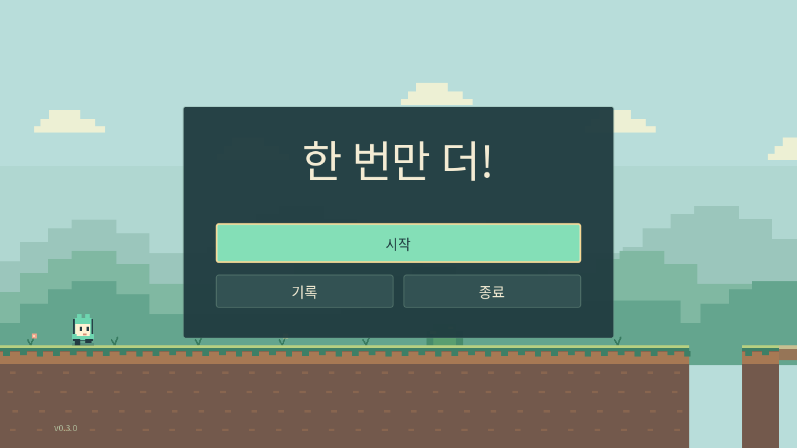
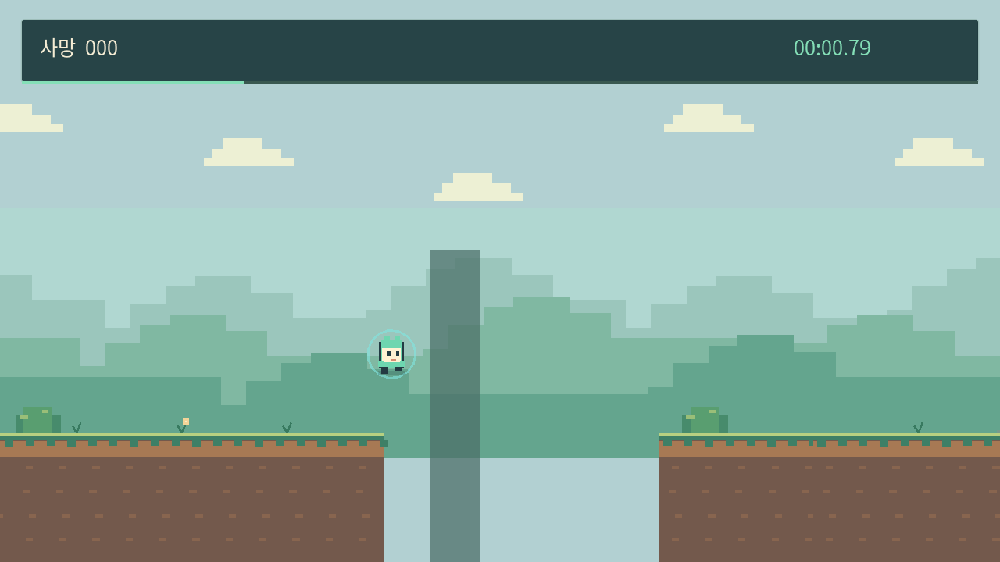

# 한 번만 더!

**[Windows 다운로드](https://github.com/nu4ddi4/side-scroller-game/releases/latest)**



## 실행

설치 파일을 실행한 뒤 시작 메뉴에서 **One More Try!**를 여세요. ZIP은 압축을 풀고 `OneMoreTry.exe`를 실행하면 됩니다.

Windows 10/11 x64 · OpenGL 3.3

## 조작

| 키 | 동작 |
| --- | --- |
| A / D, ← / → | 이동 |
| Space | 점프 |
| W / S, ↑ / ↓ | 오르내리기 |
| R | 다시하기 |
| ESC | 일시정지 |
| M | 음소거 |
| F11 | 전체 화면 |



## 업데이트

메뉴의 **업데이트 → 채널**에서 정식·베타를 선택합니다. 새 버전을 자동으로 내려받으며 **설치하고 종료**로 설치합니다. 채널을 바꿔도 다운그레이드하지 않습니다. 기존 v0.1.0 사용자는 설치 파일을 직접 실행해 주세요.

## 개발

Godot 4.6.3에서 `project.godot`을 엽니다.

```bash
godot --headless --editor --import --quit
godot --headless --fixed-fps 120 --script tests/run_tests.gd -- --test
godot --headless --fixed-fps 120 --script tests/course_tests.gd -- --test
godot --headless --fixed-fps 120 --script tests/wrong_routes.gd -- --test
godot --headless --fixed-fps 120 --script tests/playthrough.gd -- --test
python3 tools/test_updater.py
```

[개발 문서](docs/DEVELOPMENT.md) · [설계](docs/DESIGN.md) · [검증](docs/VALIDATION.md)

라이선스: `assets/fonts/LICENSE.txt`, `docs/GODOT_LICENSE.txt`, `docs/GODOT_COPYRIGHT.txt`.
